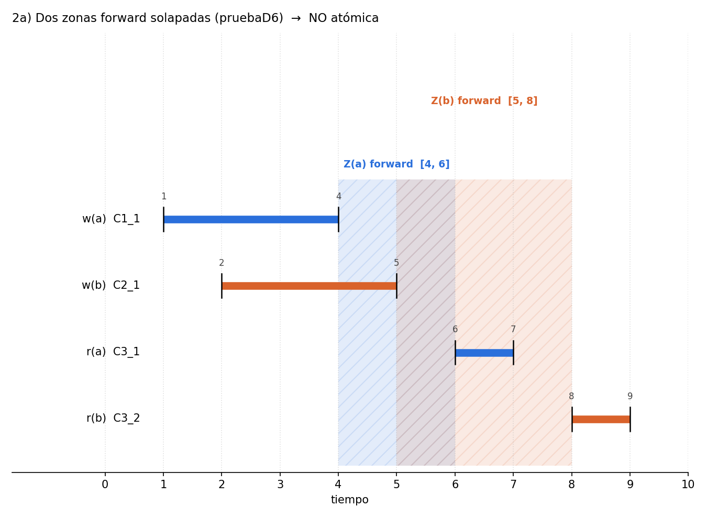
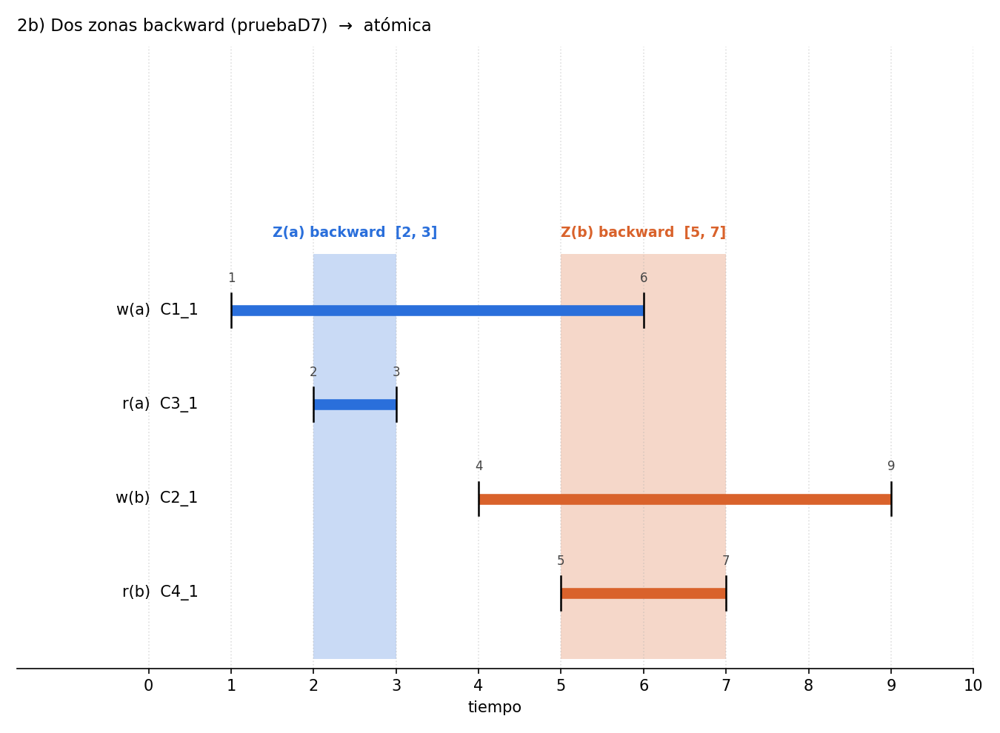
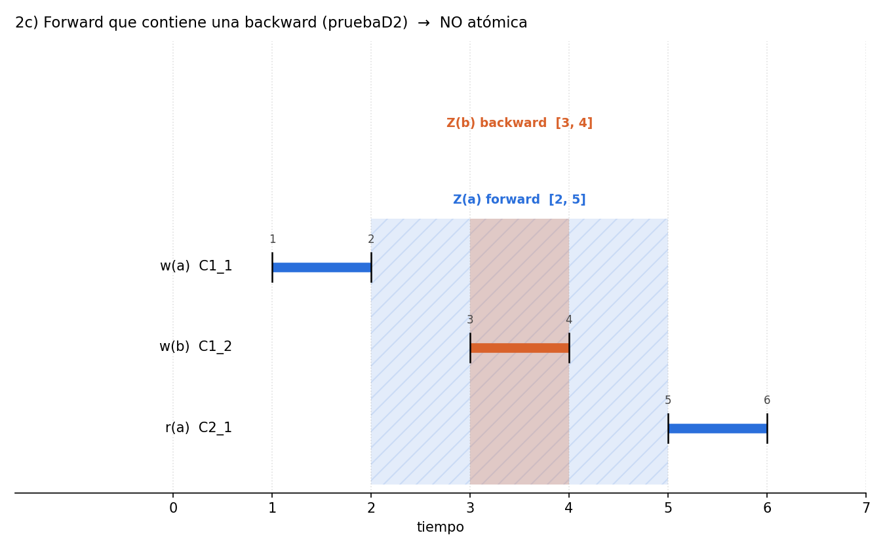

# Práctica 1 – Apartado 2: ejercicios con zonas (gráficos)

**Autor:** Danny Carrera

Antes de implementar el verificador de atomicidad, el guion pide tres ejemplos con zonas y comprobar si admiten un orden secuencial que respete la precedencia `<` de las operaciones. Cada ejemplo usa una historia real de las pruebas y se verifica con `node atomic.js`.

## Notación

- `w(x)` es la escritura del valor `x`; `r(x)`, una lectura que devuelve `x`.
- Cada operación es un segmento `[inicio, fin]` sobre el eje del tiempo.
- `op < op'` (precede) si `op.f < op'.s`; si ninguna precede a la otra, son concurrentes.
- La **zona** de un valor va de `f` (mínimo tiempo de fin de su cluster) a `s̄` (máximo tiempo de inicio).
  - Si `f < s̄` es **forward** y la zona es `[f, s̄]` (en los dibujos, sombreado con rayas).
  - Si no, es **backward** y la zona es `[s̄, f]` (sombreado liso).
- Un orden secuencial es válido si respeta la precedencia y cada lectura devuelve el valor de la última escritura anterior a ella.

Resumen:

| Ejercicio | Historia | Zonas | Orden válido | `atomic.js` |
|---|---|---|---|---|
| 2a | `pruebaD6.txt` | forward [4,6] y forward [5,8] | **No** | bad |
| 2b | `pruebaD7.txt` | backward [2,3] y backward [5,7] | **Sí** | good |
| 2c | `pruebaD2.txt` | forward [2,5] que contiene backward [3,4] | **No** | bad |

---

## 2a) Dos zonas forward solapadas

Historia (`pruebaD6.txt`):

| Operación | Intervalo |
|---|---|
| w(a) = C1_1 | [1, 4] |
| w(b) = C2_1 | [2, 5] |
| r(a) = C3_1 | [6, 7] |
| r(b) = C3_2 | [8, 9] |

**Cálculo de las zonas**
- Valor `a`: `f` = mínimo fin = 4 (el `put`), `s̄` = máximo inicio = 6 (la lectura). Como 4 < 6, es **forward [4, 6]**.
- Valor `b`: `f` = 5, `s̄` = 8. Como 5 < 8, es **forward [5, 8]**.
- Las dos zonas se solapan en `[5, 6]`.

**Comprobación: no hay orden secuencial válido**
1. `w(b)` termina en 5 y `r(a)` empieza en 6, así que `w(b) < r(a)`. Como `r(a)` devuelve `a`, la última escritura antes de `r(a)` debe ser `w(a)`, luego **`w(b)` va antes que `w(a)`**.
2. `w(a)` termina en 4 y `r(b)` empieza en 8, así que `w(a) < r(b)`. Como `r(b)` devuelve `b`, la última escritura antes de `r(b)` debe ser `w(b)`, luego **`w(a)` va antes que `w(b)`**.
3. Las conclusiones 1 y 2 se contradicen: ningún orden las cumple a la vez.

**Resultado de `atomic.js`:** `bad` (zonas forward solapadas).

---

## 2b) Dos zonas backward

Historia (`pruebaD7.txt`):

| Operación | Intervalo |
|---|---|
| w(a) = C1_1 | [1, 6] |
| r(a) = C3_1 | [2, 3] |
| w(b) = C2_1 | [4, 9] |
| r(b) = C4_1 | [5, 7] |

**Cálculo de las zonas**
- Valor `a`: `f` = mínimo fin = 3 (la lectura), `s̄` = máximo inicio = 2. Como 3 > 2, es **backward [2, 3]**.
- Valor `b`: `f` = 7, `s̄` = 5. Es **backward [5, 7]**.
- No se solapan, y dos zonas backward nunca conflictan.

**Comprobación: sí hay orden secuencial válido:** `w(a), r(a), w(b), r(b)`
- Respeta la precedencia: `r(a)` termina en 3 y `w(b)` empieza en 4, así que `r(a) < w(b)` y `r(a) < r(b)`. El resto de pares son concurrentes y pueden ordenarse libremente.
- Cada lectura devuelve la última escritura anterior: `r(a)` ve `a` y `r(b)` ve `b`.

**Resultado de `atomic.js`:** `good`.

---

## 2c) Zona forward que contiene una zona backward

Historia (`pruebaD2.txt`):

| Operación | Intervalo |
|---|---|
| w(a) = C1_1 | [1, 2] |
| w(b) = C1_2 | [3, 4] |
| r(a) = C2_1 | [5, 6] |

**Cálculo de las zonas**
- Valor `a`: `f` = 2 (el `put`), `s̄` = 5 (la lectura). Es **forward [2, 5]**.
- Valor `b` (solo tiene la escritura): `f` = 4, `s̄` = 3. Como 4 > 3, es **backward [3, 4]**, contenida por completo en `[2, 5]`.

**Comprobación: no hay orden secuencial válido**
1. `w(a)` termina en 2 y `w(b)` empieza en 3, así que `w(a) < w(b)`.
2. `w(b)` termina en 4 y `r(a)` empieza en 5, así que `w(b) < r(a)`.
3. Por tanto, en cualquier orden válido `w(b)` queda entre `w(a)` y `r(a)`, y `r(a)` leería `b` en lugar de `a`. Contradicción.

**Resultado de `atomic.js`:** `bad` (zona backward contenida en forward).

---

## Conclusión

Los tres ejemplos corresponden a las tres condiciones del teorema de Gibbons-Korach sobre las zonas: dos forward que se solapan, o una backward dentro de una forward, hacen la historia no atómica; dos backward nunca conflictan. Los resultados de `atomic.js` coinciden con la comprobación a mano en los tres casos.
